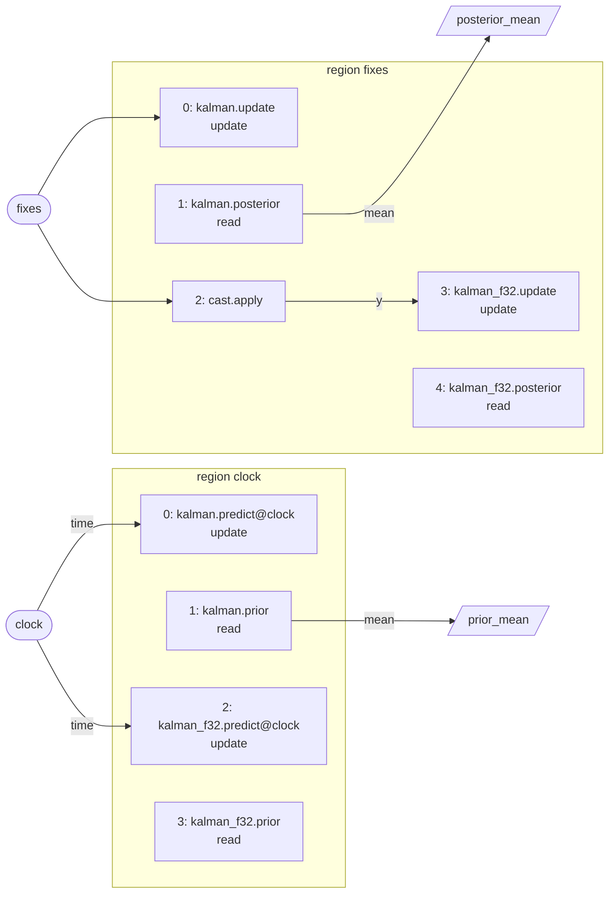

# A Walkthrough in Visual Studio

This walkthrough is for a developer new to anatomy who works in Visual Studio 2022 with MSVC. It explains why anatomy describes a mission as a graph, and what that graph is. It then builds the repository, runs the workbench's patterns, and steps through a firing in the debugger. By the end you will know what each pattern demonstrates and where to read further.

It takes about an hour, most of it spent reading the patterns' headers.

## 1. Why a graph

A mission's capability, such as estimating a state, planning or filtering a signal, has to run on more than one kind of machine. It runs on a CPU today. It must also run on a distributed data path such as the KPU's compute fabric, whose instructions are high-level transformations: linear algebra, solvers, and stateful operators such as Kalman filters. A compiler that maps a capability onto such a fabric needs to see three things ([ADR 0004](../adr/0004-domain-flow-composition.md)):

1. **The dependences between steps.** It needs to know which step reads what another wrote, so it can schedule them and allocate their buffers.
2. **The size, shape and structure of every value.** A matrix, a symmetric covariance or a bounded list of measurements, not just its scalar type, so it can divide the work and size the buffers.
3. **State as data.** A Kalman covariance kept on the fabric, or a weight matrix kept stationary, must be visible, not hidden in a class's members.

Anatomy's first design composed a stack from **slots**: C++ concepts for roles such as estimator and controller, wired together by hand in a `Stack` class. That hid all three. The dependences were function calls, the ports were typed by a scalar `T`, and the state lived in members.

So anatomy describes a capability as a **graph of operators over domains**, following [the domain flow computational model](../arch/domain-flow-model.md). The graph says *what* is computed and in what order. *How* it runs on a target, meaning layouts, schedules, tiling and placement, is the lowering's job, and anatomy leaves it to a compiler outside anatomy. The same graph then runs:

- **on the CPU**, through anatomy's stack, which fires the operators in a checked order, deterministically;
- **in replay and tests**, where every edge can be traced and compared;
- **later, on a fabric**, through an export to the domain flow compiler.

Because the graph is a checked value rather than code, anatomy can refuse a broken one before it runs, and print it, hash it and compare it.

## 2. What the graph is

The graph is described in C++ (`<branes/anatomy/flow/...>`), so the compiler checks every edge's types. A builder then checks the rest as the graph is built. The vocabulary:

| Term | What it is | Where |
|---|---|---|
| **domain** | An index set with an element type and a structure: `scalar<double>`, `vector<float, dim<16>>`, `matrix<double, dim<4>, dim<4>, structure::symmetric>`, `vector<double, bounded<256>>` (with a count). A `record` groups fields. | `flow/domain.hpp` |
| **`data<D>`** | The value of a domain, stored as its structure says: a symmetric matrix stores only its upper triangle. | `flow/data.hpp` |
| **operator** | A C++ type that computes, such as `Fir<double, 63>`. Its **binding** declares a **signature** (its ports: `in`, `out`, `inout`; and its declared state domains) and its **handlers**, each one function the graph can fire. | `flow/signature.hpp`, `flow/builder.hpp` |
| **handler** | One entry point of an operator: its in ports, its out ports, its **state role** (`none`, `read` or `update`), and whether it takes the firing's time. | `flow::handler<...>` |
| **`registered<Name, T, B>`** | An operator registered under a name that carries its element type and shape, such as `Fft_c128_256`. That name is what the graph records. | `flow/builder.hpp` |
| **instance** | A node of the graph: one operator object, named. Two instances of one registered operator are two objects. | `fl::instance<Op>(g, "fir")` |
| **input, constant, output** | The graph's external ports. An input is handed messages by a driver, a constant holds a value fixed when the graph is built (weights, taps), and an output is read after a region runs. | `fl::input`, `fl::constant`, `fl::output` |
| **region and trigger** | A trigger is an input or a clock tick. Its region is the ordered list of firings that run each time the trigger fires. | `g.region(trigger)` |
| **firing** | One call of a handler, in a region. The order of the `fl::fire` calls is the region's order. | `fl::fire<"handler">(region, node, sources...)` |
| **edge** | A firing's in port reads an out port of an earlier firing, an input or a constant. An edge between regions needs a **rate rule**: `hold` reads the latest value, and `accumulate<N>` reads a window of the values written since the reader's region last ran. | `fl::hold(x)`, `fl::accumulate<N>(y)` |
| **composite and body** | A mission fixes its **composites**: named operators with fixed ports, such as an estimator. A scoreboard baseline fills each with a **body**, a graph of its own, but keeps their connections. A research baseline, like every workbench pattern, fires operators directly between the external ports. | `flow/builder.hpp` |
| **checks** | G1–G9 ([the flow-graph plan](../plan/flow-graph/README.md)). What the types know is checked at compile time, with a `static_assert` naming the invariant: a firing names a handler of its node (G2), gives each in port one source (G3), and joins ports of one domain (G4). The rest is checked as the graph is built, and `build()` returns the first invariant broken, naming the node or firing: within a region, the edges are acyclic and a node's state is updated at most once (G5); each trigger has one region (G6); an edge between regions has a rate rule (G7); a graph has its baseline class's shape (G8). | `flow/builder.hpp`, `flow/graph.hpp` |
| **canonical form and hash** | The checked graph as text, one line per instance, region, firing, edge and output. Its hash identifies the graph. | `flow::canonical`, `flow::mermaid` |
| **computational domain** | What a handler computes, point by point: an index space, equations over it, and where its ports and state enter and leave. It is declared beside the handler and checked (K1–K8). | `flow/compute.hpp` |

**How it runs.** The same function describes the graph whatever builder it is given. With `flow::builder`, it only checks the graph and returns it. With `flow::stack_builder`, it also constructs the operators and returns a `flow::stack`, the CPU program. A driver hands the stack its inputs in time order. Each input runs its trigger's region: the stack first fills any `accumulate` windows the region reads, then calls each firing's handler in order, passing references to the values on its edges. No virtual dispatch is involved. An observer, if one is set, sees each firing's outputs, and that is how a trace is written.

## 3. Set up Visual Studio

**Prerequisites:**
- Visual Studio 2022 with the *Desktop development with C++* workload.
- **CMake 4.0 or later on your `PATH`.** The CMake bundled with Visual Studio 2022 is 3.x, and the presets require 4.0. Install it from <https://cmake.org/download/> and check with `cmake --version` in a new terminal.
- Git, and network access for the first configure: CMake fetches Catch2, yaml-cpp, reflex (which brings MTL5) and Universal.

**Configure and open the solution.** From a terminal at the repository's root:

```powershell
cmake --preset msvc            # generates build\msvc\branes_anatomy.sln (Visual Studio 17 2022, x64)
```

Then, in Visual Studio, use *File → Open → Project/Solution* and open `build\msvc\branes_anatomy.sln`. Solution Explorer groups the targets in folders:

- `Workbench`: `anatomy_workbench_run`, the tool this walkthrough uses;
- `Tests/sdk`, `Tests/workbench`, and the other `Tests/...` folders: one Catch2 executable per `tests/<layer>/<name>.cpp`, such as `workbench_dsp` and `workbench_compute`;
- `Tests/headers`: the checks that every header compiles on its own.

Choose the *Debug* configuration and build the solution (*Ctrl+Shift+B*). The same can be done from the terminal:

```powershell
cmake --build --preset msvc-debug
ctest --preset msvc-debug       # every test, with the output of any that fails
```

> **Opening the folder instead.** Visual Studio can open the repository folder and read `CMakePresets.json` directly, but its open-folder mode runs its own bundled CMake, which is too old. To use that mode, point it at CMake 4 in a `CMakeUserPresets.json` (not committed) with the vendor setting `"microsoft.com/VisualStudioSettings/CMake/1.0": { "cmakeExecutable": "C:/Program Files/CMake/bin/cmake.exe" }`. The generated solution avoids the question.

> **The CI presets.** CI builds `msvc-ninja` and `msvc-ninja-debug`. They use Ninja, and need the MSVC environment active, as in the *Developer PowerShell for VS 2022*. Use them to reproduce a CI failure exactly.

## 4. Run your first pattern

The workbench ([guide](../guides/the-workbench.md)) runs **patterns**: small graphs with no vehicle or simulator, each with synthetic sources and an **oracle** that checks the outputs against mathematics.

In Solution Explorer, right-click `anatomy_workbench_run` and choose *Set as Startup Project*. Under *Properties → Debugging → Command Arguments*, enter `dsp`, then run with *Ctrl+F5*. The binary is `build\msvc\workbench\Debug\workbench_run.exe`, so you can also run it from a terminal:

```text
> build\msvc\workbench\Debug\workbench_run.exe dsp
dsp: 12 checks, all passed
  PASS  frames                                           32 (at least 2)
  PASS  frames whose window isn't 256 samples            0 (at most 0)
  PASS  filtered frame against the FIR, relative         7.42775e-16 (at most 1e-12)
  PASS  spectrum against a DFT, relative                 3.83533e-16 (at most 1e-12)
  ...
```

Each line is one check of the oracle: its value, then its tolerance. Try the flags:

| Arguments | What it shows |
|---|---|
| `mlp`, `kalman`, `dsp` | each pattern's oracle, at its default number of inputs |
| `dsp --tolerance-scale 0.1` | the margin: every tolerance divided by ten, and the pattern still passes |
| `kalman --inputs 2000` | an oracle that fails: the Riccati check needs 500 updates, which 2000 inputs (about 180 updates) don't reach. The exit code is 1 |
| `kalman --inputs 10 --mermaid k.mmd --canonical k.txt` | the graph as a flowchart and as its canonical form ([reading a graph](../guides/reading-a-graph.md)) |
| `dsp --inputs 600 --trace a.brtrace` | every firing's outputs, written to a trace that `trace_compare` reads |
| `mlp --check` | each handler's computational domain checked, with its class, depth and operation counts |
| `mlp --compute cd.txt` | each computational domain written as text |

Paste the `.mmd` file into a ` ```mermaid ` block on GitHub, or into <https://mermaid.live>, to see the flowchart.

## 5. Step through a firing in the debugger

The path from `main` to an operator is short, and worth stepping once. In the Debug configuration, with `dsp --inputs 300` as the command arguments, set breakpoints at:

1. **`workbench::run`** (`workbench/include/branes/anatomy/workbench/pattern.hpp`). It builds the pattern's stack (`build<P>`), installs the trace's observer, and calls the driver.
2. **`workbench::drive`** (`workbench/driver.hpp`). It picks the earliest next message among the sources (the first declared, at a tie) and hands it to the stack.
3. **`flow::stack::input`** (`sdk/include/branes/anatomy/flow/builder.hpp`). It stores the message, pushes it to any `accumulate` window that reads it, and runs its trigger's region.
4. **`flow::stack::run`**, just below it. This is the whole execution model in fifteen lines: fill the region's windows, then call each firing's thunk in order. The thunk calls the handler's `call` with the firing's in-port values.
5. **`FirBinding::filter::call`** (`workbench/patterns/dsp.hpp`). This is the FIR, called once per sample. Watch `op.delay`, its declared state, shift by one each time.

Continue until the 256th sample's time. The frame tick then runs the frame region. Its first firing, `FramerBinding::apply::call`, receives the `window` the `accumulate<256>` edge built: 256 filtered samples, and the number dropped. Step on through `Hann`, `ToComplex`, `Fft` and `MagnitudeOp`.

Two things to notice:

- **The handlers never call each other.** Each reads values the stack hands it and returns values the stack stores. The graph holds every dependence.
- **`hand_run` does the same by hand.** Each pattern's `hand_run` calls the same handlers directly, in the graph's order. The tests require the stack's outputs to equal it bit for bit (W1), so a difference is a fault in the graph's execution, not in an operator.

## 6. The patterns

Each pattern is one header in `workbench/include/branes/anatomy/workbench/patterns/`, holding its operators, their bindings, its graph, its sources, its run by hand and its oracle. Its tests are `tests/workbench/workbench_<name>.cpp`. Read each header top to bottom: the comment at its top states what it computes and what its oracle checks.

### The MLP (`mlp.hpp`)

`y = W₂·tanh(W₁·x + b₁) + b₂`, from 16 inputs to 32 hidden units to 8 outputs, in one region fired by each input.

**What it demonstrates:**
- **Shaped domains on the edges:** a `matrix<float, dim<32>, dim<16>>` and the vectors it maps, instead of a scalar type.
- **Constants with values:** the weights are drawn from the seed when the graph is built, and every firing reads them by reference.
- **An element type per edge:** layer 1 runs in `f32` and layer 2 in `f64`, joined by a `Cast` operator.
- **Operators named by type and shape:** `Linear_f32_32x16` and `Linear_f64_8x32` are one template, registered twice.

**Its oracle:** a direct evaluation in `long double`. The output agrees to 1e-5, which layer 1's `f32` sets, and layer 2, given layer 1's output, to 1e-12.

**Try:** `mlp --check`. The first line reads `Linear_f32_32x16.apply uniform, depth 18, 512 mul, 512 add`. Those are the 32·16 multiply-adds, derived from the declaration, and a chain of 16 + 2 dependences.

### The Kalman filter (`kalman.hpp`)

A constant-velocity filter in the plane. It predicts on a 100 Hz clock and updates, in Joseph form, on up to four position fixes at 10 Hz. It runs twice, in `f64` and in `f32`, so the oracle can compare them.



(The flowchart is trimmed to two outputs; `workbench_run kalman --mermaid` prints all six.)

**What it demonstrates:**
- **Declared state, shared by two regions:** one `Kalman` operator has four handlers. `predict` and `update` update its state (`x`, `P` and `t_last`, the time of the last predict) in two regions fired by two triggers. `prior` and `posterior` only read it. At a shared time, the clock's region runs first, as the driver orders the sources, so an update applies to the predicted state.
- **A time handler:** `predict@clock` takes the time of the input that fires it, which the flowchart draws as a `time` edge.
- **A structured domain:** `P` is a symmetric 4 × 4 `data<D>`, stored packed, as its upper triangle.
- **A bounded domain:** the fixes are `matrix<double, bounded<4>, dim<2>>`, with a count, sometimes zero.
- **Arithmetic in MTL5:** through `workbench/mtl5.hpp`, which gives MTL5 views of `data<D>` without copying.

**Its oracle:** `P` stays positive definite. After 500 updates it agrees with the steady-state Riccati solution to 1e-9. The normalized estimation error lies within its 95 % chi-square bounds, and the `f32` filter agrees with the `f64` one to 1e-4.

**Try:** `kalman --check`, and compare the `predict` and `update` lines. Then read `KalmanBinding::update` and its declaration in `namespace declare`. That declaration is a 4-index system that applies each fix in turn.

### The DSP spectral pipeline (`dsp.hpp`)

Samples at 8192 Hz pass through a 63-tap band-pass FIR, one per sample. Every 256 samples, a frame tick takes the latest 256 filtered samples, then applies a Hann window, a radix-2 FFT and a magnitude. The flowchart is in [the workbench guide](../guides/the-workbench.md#reading-its-graph).

**What it demonstrates:**
- **Two rates, and the `accumulate` rule:** the sample region fires 256 times for each firing of the frame region. The edge between them, `accumulate<256>`, hands the frame region a window of every value written since it last ran. Its `dropped` count is how the oracle proves no sample was lost.
- **State as a delay line:** the FIR's 63 past samples are its declared state.
- **Complex elements:** the spectrum is `vector<std::complex<double>, dim<256>>`.
- **A non-affine computational domain:** the FFT's butterflies read their partner at `p + 2ˢ⁻¹`, an index that depends on the stage through a shift. `dsp --check` prints the FFT as `non-affine, depth 18, 1024 mul, 1024 add, 1024 sub`: (N/2)·log₂N butterflies, and a critical path of 2·log₂N + 2.

**Its oracle:** the filtered frame against the FIR evaluated directly, and the spectrum against a direct DFT, both to 1e-12. Parseval's theorem holds. The two loudest bins are the pass-band tones, within 1 % of their predicted magnitude, and the stop band is at least 40 dB down.

**Try:** `dsp --compute cd.txt` and read the FFT's block. Stage 0 reads the input in bit-reversed order, and each later stage defines a twiddle product `t` and then the butterfly's two outputs.

### What every pattern's tests check

| Id | Property | Where |
|---|---|---|
| W1 | The stack's outputs equal `hand_run`'s, bit for bit | `workbench_<name>.cpp` |
| W2 | The oracle passes, and fails when an output is perturbed | `workbench_<name>.cpp` |
| W3 | Two runs of one seed write byte-identical traces | `workbench_<name>.cpp` |
| W10–W13 | Each handler's computational domain passes K1–K7 and has its stated class (K8). Evaluated on every firing's values, it gives what the handler gives, in any order its dependences allow, and its operation counts are their closed forms | `workbench_compute.cpp` |

To run one test executable from Visual Studio, set it as the startup project and give Catch2 a tag as its argument, such as `[dsp]` for `workbench_compute`.

## 7. The computational domain

A node of the graph names an operator, but a compiler also needs to know what the operator computes. Each workbench handler therefore declares its **computational domain** as a `static constexpr cd::system compute` beside its `call` ([the plan](../plan/computational-domain/README.md)). For `Linear`, `y = W·x`, the declaration's text is:

```text
# Linear_f32_32x16.apply
param w[0] = 32
param w[1] = 16
stage 0: (i, j) | 0 <= i < w[0], 0 <= j < w[1]
  var acc: f32
  init acc = 0  | j == -1
  acc(i, j) = acc(i, j - 1) + (w(i, j) * x(j))
  y(i) <- acc(i, j)  | j == w[1] - 1
```

It has an index space `(i, j)` bound from the port `w`'s extents, a running sum seeded on the face `j = −1`, and the output `y(i)` leaving on the face `j = C − 1`. From it, anatomy derives the operation count (W13) and the dependence depth. The workbench's evaluator runs the declaration point by point, as a third oracle, and its result must equal the handler's exactly (W11). K1 and K2 are checked when the binding is registered, so a declaration that names a port the handler doesn't have doesn't compile.

## 8. The patterns still to come

[ADR 0005](../adr/0005-application-tier.md) lists nine patterns. Three run today. Each of the other six lands with the feature of the machinery it exercises:

| Pattern | Step | The feature it lands with |
|---|---|---|
| PID control | C4 | a **carried edge**: a loop closed from one firing of a region to the next |
| attitude filter | C5 | a **unit-norm** quaternion domain |
| convolution | C6 | **rank-3** domains, and a sliding-window computational domain |
| stencils | C7 | the **halo** of a divided computational domain |
| SOR/SSOR | C8 | the **dependence depth**, which says what can run in parallel |
| QR | C9 | a **triangular** computational domain, and an `inout` port |

The [computational domain plan](../plan/computational-domain/README.md#progress) tracks them.

## 9. Notes for MSVC

- **Warnings are errors** on anatomy's own targets (`/W4 /permissive-`, `cmake/warnings.cmake`), as on GCC and Clang. The ones that most often catch code written on Linux are C4189, a local initialized but not used, and C4702, unreachable code. A fold expression's unused counter needs `(void)k;`.
- **`/utf-8` and `/Zc:preprocessor`** are set for every target, so comments and strings may be UTF-8.
- **Keep Catch2 test names ASCII.** On Windows, ctest passes a name with `·`, `²` or `→` to the test garbled, Catch2 matches nothing, and the test fails. Write `R*C`, `n^2` and `->` in a `TEST_CASE` name.
- **Floating point.** The workbench requires each handler to round every operation, so the evaluator can match it exactly. GCC and Clang get `-ffp-contract=off`, and MSVC's default `/fp:precise` already doesn't contract. Don't build the workbench with `/fp:fast`.
- **Traces don't match across compilers.** MSVC's `sin`, `cos` and `log` differ from glibc's in the last bits, so a trace written on Windows differs from one written on Linux. Within one compiler, a seed's traces are byte-identical (W3). Across compilers, the oracles' tolerances are the check.

## Where next

- [The workbench](../guides/the-workbench.md): every flag, the trace, and how to add a pattern.
- [Reading a graph](../guides/reading-a-graph.md): the canonical form and the flowchart, line by line.
- [The domain flow computational model](../arch/domain-flow-model.md): domains, phases, operators, events and lowering.
- [ADR 0004](../adr/0004-domain-flow-composition.md) and [ADR 0005](../adr/0005-application-tier.md): why the graph, and why the patterns.
- [Repository layout](repository-layout.md): where each library and header lives.
