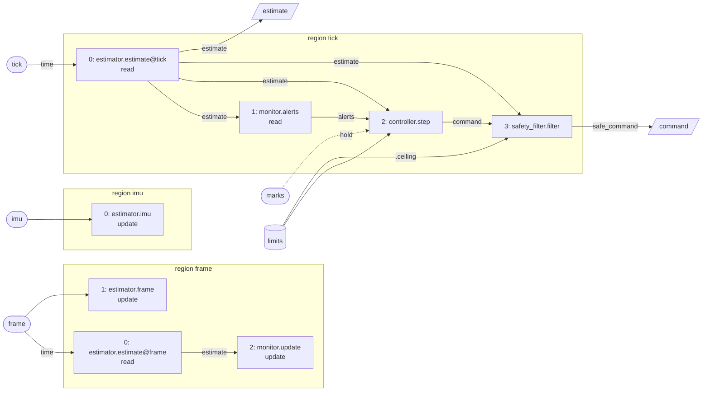

# Reading a Graph

A graph build's stack is the graph its mission builds in C++ ([ADR 0004](../adr/0004-domain-flow-composition.md), decision 2). That code is the graph, but it is hard to read the layout from it: which region runs what, in what order, and where each value comes from. anatomy prints the checked graph in two forms. Both come from the graph the stack was built from, so they can't disagree with it.

| Form | Function | What it is for |
|---|---|---|
| `text` | `flow::canonical(g)` | The canonical form: one line per composite, instance, region, firing, in port and output. The graph's hash is of this text, so two builds whose text differs have different hashes. |
| `mermaid` | `flow::mermaid(g)` | A [Mermaid](https://mermaid.js.org/) flowchart, for reading. It is not hashed. |

Both are declared in `flow/graph.hpp`.

## Printing a graph

`harness::print_graph` (`harness/graph.hpp`) writes a graph in the form named, `text` or `mermaid`, and returns the error text for any other. It is for the missions' graph harnesses, which take `--print-graph text` or `--print-graph mermaid` once they wire it: they build the stack, print its graph and exit, without running. Until a mission does, its graph can be printed from code:

```cpp
#include <branes/anatomy/harness/graph.hpp>

namespace an = branes::anatomy;

if (const auto form = args->value(std::string(an::harness::print_graph_option))) {
    // ... build the stack ...
    if (const auto e = an::harness::print_graph(stack->stack().graph(), *form, std::cout)) {
        return fail(*e);
    }
    return 0;
}
```

To view the flowchart, paste it into a ` ```mermaid ` block of a markdown file on GitHub, which renders it, or into <https://mermaid.live>. The docs site shows it as code.

## Reading the flowchart

- **Regions:** each region is a subgraph named after its trigger, with its firings in the order they run.
- **Firings:** each firing is a box labelled with its index in the region's order and `operator.handler`, plus `@input` for a time handler. Its second line names the composite handler it implements, when that differs from the call, and whether it reads or updates its operator's state.
- **Inputs, constants and outputs:** an input is a rounded node, a constant a cylinder and an output a slanted box.
- **Edges:**
  - An edge is labelled with the out port it reads, and with the fields projected from it (`.ceiling`).
  - A `time` edge runs from the input whose time a time handler takes.
  - A dotted edge holds: it reads the latest value of a source that runs at another rate, an input with a trigger of its own or a firing of another region.

The test mission's scoreboard graph (`tests/fixtures/flow/test_mission.hpp`), as `flow::mermaid` prints it:



In the tick region, the controller steps on the estimate, the limits, the monitor's alerts and the latest marks, which have a trigger of their own. The safety filter then takes the estimate, the command and the limits' ceiling. The outputs take the estimate and the safe command.
