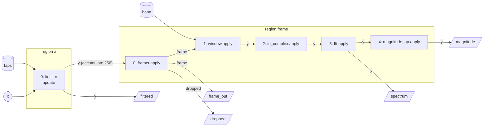

# The Workbench

The workbench ([ADR 0005](../adr/0005-application-tier.md), decision 1) is where anatomy's graph machinery is developed and checked before a mission uses it. It runs **patterns**: small graphs with no vehicle, world, simulator or scorer. Each has synthetic sources and an oracle, and the oracle judges the outputs against mathematics rather than against another run. A new feature of the machinery, such as a domain's structure, a rate rule or a lowering, lands with a pattern that uses it and an oracle that checks it.

It is in `workbench/` and builds the library `branes::anatomy_workbench` and the tool `workbench_run`. It is built with the tests (`ANATOMY_BUILD_WORKBENCH`, which defaults to `ANATOMY_BUILD_TESTS`). It is not installed or exported, so no mission links a reference operator. Its tests are in `tests/workbench/`.

## The patterns

| Pattern | What it is | What it first needed | Its oracle checks |
|---|---|---|---|
| `mlp` | `y = W₂·tanh(W₁·x + b₁) + b₂`, 16 → 32 → 8; layer 1 in `f32`, layer 2 in `f64` | shaped `data<D>` on edges, constants with values, an element type per edge | the output against `long double` to 1e-5; layer 2, given layer 1's output, to 1e-12 |
| `kalman` | constant velocity in the plane; predict on a 100 Hz clock, update in Joseph form on 10 Hz fixes; in `f64` and `f32` | a symmetric covariance in a packed `data<D>`; one operator's state updated in two regions at shared times; arithmetic in MTL5 through `workbench/mtl5.hpp` | `P` positive definite after every firing; the Riccati steady state to 1e-9; the NEES within its 95 % bounds; `f32` against `f64` to 1e-4 |
| `dsp` | at 8192 Hz, a band-pass FIR per sample, then per frame of 256: `accumulate<256>`, a Hann window, a radix-2 FFT and a magnitude | the `accumulate` rate rule; complex elements | full windows; the FIR and the spectrum against `long double` (a direct DFT) and Parseval, to 1e-12; the tones' bins, and their magnitudes against `A·\|H(f)\|·Σw/2` to 1 %; 40 dB of stop band |
| `pid` | on a 100 Hz clock, three loops of a controller (P, PI and PID) and a first-order plant `y' = (K·u − y)/τ`, discretized exactly, toward a step setpoint | the `carried` edge, which closes a loop within a region: each controller reads its plant's output from the previous tick | the P loop against its closed form to 1e-12; the PI and PID loops' errors below 1e-9 after 20 time constants; the PI loop's overshoot against its poles' modal form to 1 % |

Each pattern is one header, `workbench/include/branes/anatomy/workbench/patterns/<name>.hpp`, holding its operators, their bindings, its graph, its sources, its run by hand, and its oracle.

## Running a pattern

```text
workbench_run <mlp|kalman|dsp|pid> [--inputs N] [--seed S] [--trace run.brtrace]
              [--mermaid g.mmd] [--canonical g.txt] [--tolerance-scale K]
```

After a build, the tool is at `build/<preset>/workbench/workbench_run`. It runs the pattern with its default configuration, or with the seed given, and prints its oracle's report: one line per check, with the value and the tolerance.

```text
$ workbench_run dsp
dsp: 12 checks, all passed
  PASS  frames                                           32 (at least 2)
  PASS  frames whose window isn't 256 samples            0 (at most 0)
  PASS  samples dropped                                  0 (at most 0)
  PASS  filtered frame against the FIR, relative         7.42775e-16 (at most 1e-12)
  PASS  spectrum against a DFT, relative                 3.83533e-16 (at most 1e-12)
  ...
  PASS  stop-band tone's attenuation [dB]                64.3031 (at least 40)
```

- `--inputs N`: how many inputs the driver hands the stack, counting every source's. Each pattern has its own default, which is what its oracle needs: 100 for the MLP, 22 000 for the Kalman filter (2000 updates), 8224 for the DSP pipeline (32 frames), and 1500 for PID control (15 s at 100 Hz).
- `--seed S`: the seed that every source and constant is drawn from.
- `--tolerance-scale K`: multiplies every check's upper tolerance by K. A pattern that still passes at `K = 0.1` has ten times the margin it needs. `K = 0` makes every inexact check fail.
- The exit code is 0 if every check passes, 1 if one fails, and 2 for a usage error or a file the tool can't write, as `trace_compare`'s is.

## Reading its graph

`--mermaid g.mmd` and `--canonical g.txt` write the pattern's checked graph, without running it any differently. They are the two forms that [Reading a Graph](reading-a-graph.md) describes. The DSP pipeline's flowchart:



The FIR runs in the sample region and updates its state, its delay line. The dotted edge is the `accumulate` rule: the frame region reads a window of the filtered samples written since it last ran. In the canonical form, the same edge is the line `in firing x#0 y accumulate 256`, and each operator is registered under a name that carries its element type and shape, such as `instance fft Fft_c128_256 -`. That name is what a graph document will refer to.

## Reading its trace

`--trace run.brtrace` writes every firing's out ports, encoded by the workbench's codecs (`workbench/codecs.hpp`), as [the flow testing plan](../plan/flow-testing/README.md) describes. A `data<D>` is encoded as its count and then its elements' bit patterns, so two values with the same rows in use encode alike. `trace_compare` names the first edge on which two traces differ:

```text
$ workbench_run dsp --inputs 600 --trace a.brtrace
$ workbench_run dsp --inputs 600 --seed 2 --trace b.brtrace
$ trace_compare --a a.brtrace --b b.brtrace
trace_compare: a.brtrace and b.brtrace differ: record 0: x[0].y (fir.filter) at t=0 ns has another value
```

Two runs of one seed, on one compiler, have byte-identical traces (W3). Across compilers, floating point and the libraries' `sin`, `cos` and `log` differ in the last bits. There, the oracle's tolerances are the check, not the bytes.

## How a pattern is checked

Every pattern has two oracles, and its tests run both (`tests/workbench/workbench_<name>.cpp`):

- **W1, its run by hand.** `hand_run` calls the pattern's operators directly, in the graph's order, on the same stream, and its samples must equal the stack's bit for bit. A difference is a fault in the graph's execution: the stack's order, a rate rule, or an edge wired to the wrong port.
- **W2, its oracle.** `pattern::oracle` checks the outputs against closed-form mathematics, in `long double` and without the operators, to a tolerance. A failure is a fault in an operator. The tests also show that the oracle can fail: they perturb an output, by a part in 10⁹ or a few percent, and check that the matching check fails.
- **W3, determinism.** Two runs of one seed write byte-identical traces.

## Adding a pattern

A pattern `P` is a type that meets the interface in `workbench/pattern.hpp`; `workbench::run<P>` then builds, drives and traces it.

1. **Its domains and operators.** Write the operators as plain reference implementations, to be checked, not to be fast. Give each a binding with its signature and handlers, and register it under a name with its element type and shape (`fl::registered<"Fft_c128_256", ...>`). An operator with parameters takes them `from_context`, from the pattern's `context`, which holds its `config`. Arithmetic on matrices goes through `workbench/mtl5.hpp`. Don't write MTL5 views by hand: copying one makes it allocate storage of its own.
2. **Its configuration.** Put the rates, the parameters and a seed in a `config` struct with defaults. Draw randomness from `workbench::rng` and `substream(seed, k)`, never from the standard distributions, which differ between GCC, Clang and MSVC.
3. **Its graph.** `P::graph(G&, const config&)` is a template over the builder, so `flow::builder` checks it (`describe<P>`) and `flow::stack_builder` runs it (`build<P>`). It returns the pattern's `ports`. Put constants with values here, such as weights, taps and windows, computed from the configuration.
4. **Its sources.** `P::sources(ports, config)` returns one `workbench::source` per input, built from `sequence` or `clock`. At a shared time, the driver hands them over in the order they are listed.
5. **Its samples.** `P::collect` reads what the oracle needs from the stack after each input. Keep each sample small, because a run collects one per input.
6. **Its run by hand and its oracle.** Write `hand_run(config, inputs)` and `P::oracle(config, samples)`. The oracle returns a `report` of `at_most` and `at_least` checks. Choose tolerances from the arithmetic, not from a run. Then use `--tolerance-scale` to see how much margin they have.
7. **Its codecs.** `P::codecs()` registers a codec for each out port's message type (`add_data<D>`), so that the trace holds their values.
8. **Its tests and its tool.** Add `tests/workbench/workbench_<name>.cpp`, with W1, W2 (including an output perturbed until the oracle fails) and W3. The directory is globbed, so it needs no CMake change. Add the pattern to `workbench_run` (`workbench/apps/workbench_run/main.cpp`) and its test (`tests/apps/workbench_run_test.cmake`). The workbench's tests run in under 10 s in a debug build.
